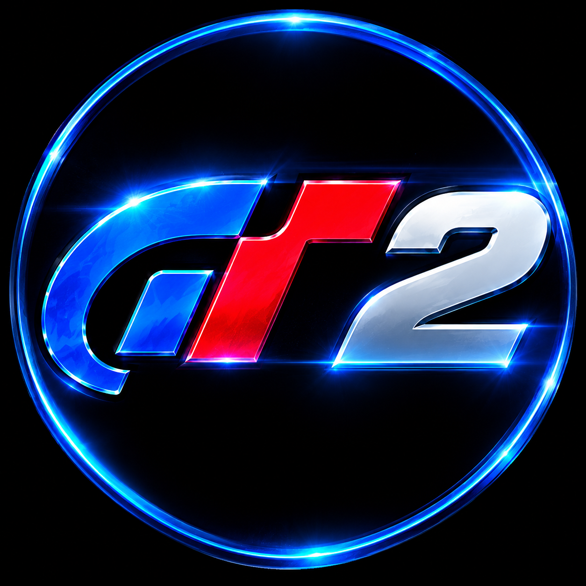

# GT2 Android

**Gran Turismo 2 — Android port with touchscreen controls and a mobile-optimized interface.**

---

## 🌐 Choose your language / Выберите язык

<table>
<tr>
<td align="center" width="50%">

# 🇬🇧 English

[**Open English README →**](README_EN.md)

</td>
<td align="center" width="50%">

# 🇷🇺 Русский

[**Открыть README на русском →**](README_RU.md)

</td>
</tr>
</table>

---

## 🎬 Video demonstration / Видео

[**▶ Watch on YouTube / Смотреть на YouTube**](https://www.youtube.com/watch?v=_uKeeDgy1H4)

---

**Quick links / Быстрые ссылки:** [Latest release](https://github.com/PhantasmProject/gt2-android/releases/latest) · [Installation guide](docs/INSTALLATION.md) · [Game data preparation](docs/GAME-DATA.md) · [Build from source](docs/BUILD.md)
