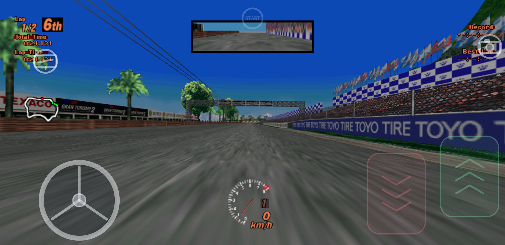
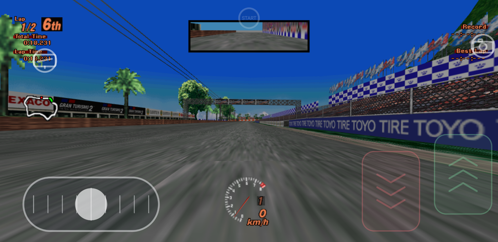
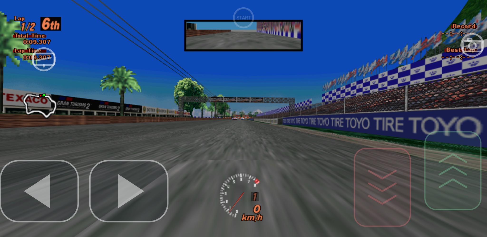
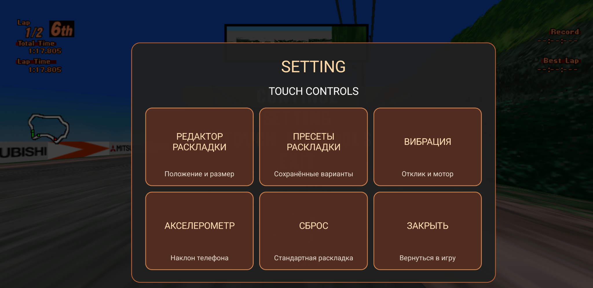
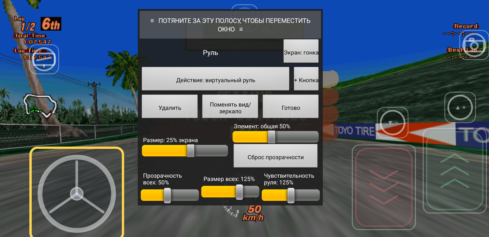
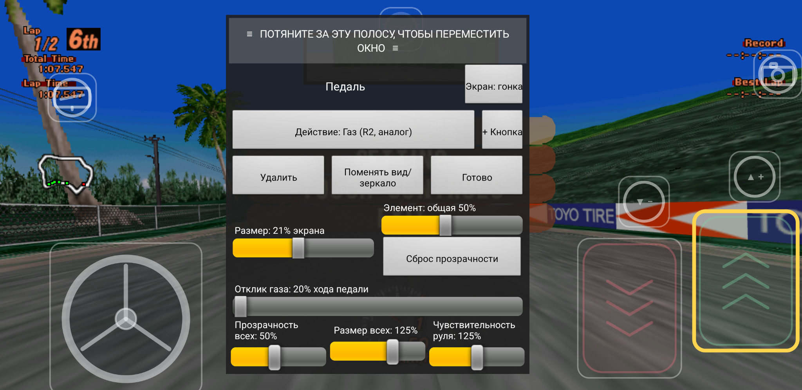
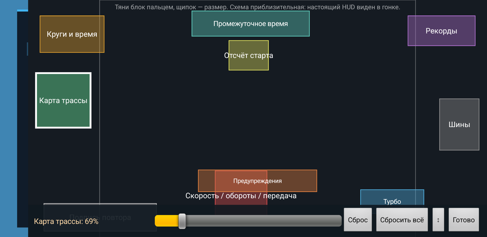
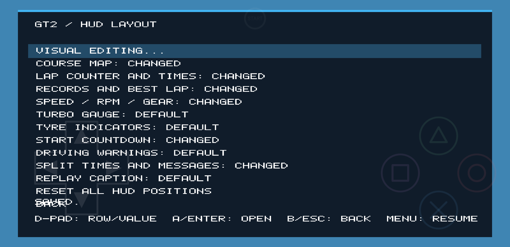
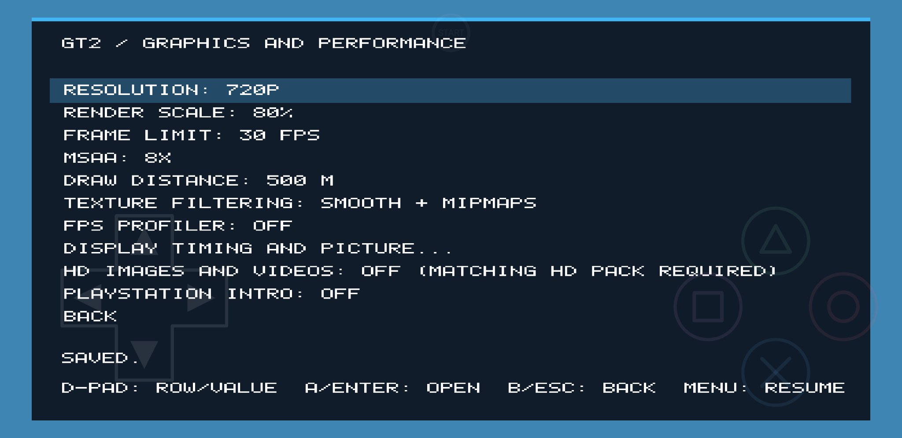
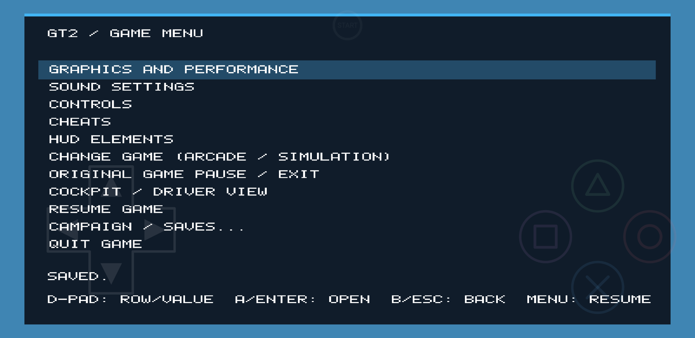

**Language / Язык:** 🇬🇧 English · [🇷🇺 Русский](README_RU.md) · [🏠 Main page](README.md)

---

## 🇬🇧 English

### About

**GT2 Android** is an Android port of Gran Turismo 2, adapted for regular 2D screens and touchscreen gameplay. It builds on the Android/VR work of the original [Gran Turismo 2 PC & VR project](https://github.com/dubrovskiy-yevhen-stakelogic/gt-2-pc), reworked here for a traditional mobile experience without a VR headset.

### Features

- Three steering options: virtual steering wheel, steering slider, and left/right buttons.
- Adjustable steering sensitivity and throttle response.
- Customizable HUD: move and resize on-screen elements.
- Touch-button vibration and in-game rumble feedback.
- Live control and interface settings, applied without restarting the game.
- In-game graphics, sound and controls settings.

### Screenshots

| Virtual steering wheel | Steering slider |
|:---:|:---:|
|  |  |

| Left/right buttons | Touch settings |
|:---:|:---:|
|  |  |

| Steering editor | Throttle editor |
|:---:|:---:|
|  |  |

| HUD editor | HUD layout |
|:---:|:---:|
|  |  |

| Graphics settings | Game menu |
|:---:|:---:|
|  |  |

### Requirements

- Android 9 or newer, ARM64 device.
- A GPU driver supporting **Vulkan 1.3 with dynamic rendering**.
- Compatibility depends on the device, Android version and graphics driver. Vulkan 1.3 support is mandatory; some older Adreno devices may need a compatible Turnip driver.

### Quick start

1. Open [**Releases**](https://github.com/PhantasmProject/gt2-android/releases/latest).
2. Download the Android APK and install it on your phone. If Android asks, allow installation from that source.
3. Prepare your own GT2 game data using the Windows tool described in [Game data preparation](docs/GAME-DATA.md).
4. Transfer the prepared ZIP to your phone and extract it there.
5. Launch GT2 Android. When the Android folder picker appears, select the folder containing `arcade` and/or `simulation` (or select one of those folders directly).
6. Grant the requested storage access and return to the game.

The game reads the selected folder in place. It does not copy or convert game data on the phone.

### Documentation

| Guide | Description |
|---|---|
| [Installation on Android](docs/INSTALLATION.md) | APK installation, first launch, data folder selection and troubleshooting |
| [Preparing game data on Windows](docs/GAME-DATA.md) | `GT2 Preparing Data.zip`, `INSTALL.bat`, supported disc images and transfer to phone |
| [Build from source](docs/BUILD.md) | WSL/Ubuntu setup, APK build script and all build modes |
| [Android technical notes](docs/ANDROID.md) | Runtime behavior, touch controls, graphics and developer details |

### Releases and downloads

The **Releases** page is the official download location:

- [Latest GT2 Android release](https://github.com/PhantasmProject/gt2-android/releases/latest)
- [All releases](https://github.com/PhantasmProject/gt2-android/releases)

Download the APK to install the game. The source ZIP is intended for developers who want to inspect or build the project. The separate **GT2 Preparing Data.zip** archive is the Windows game-data preparation toolkit; it is not the Android APK.

### Tested devices

Testing has been performed on:

| Device | SoC | GPU |
|---|---|---|
| Google Pixel 3 XL | Qualcomm Snapdragon 845 | Adreno 630 |
| Samsung Galaxy S24 Ultra | Qualcomm Snapdragon 8 Gen 3 | Adreno 750 |

These are the currently reported test devices, not a complete compatibility list.

### Project status

🚧 **Work in progress.** This is an early public release. Bugs, performance differences and device-specific graphics issues are possible. Please include your device model, Android version and relevant `gt2game-error.log` information when reporting a problem.

### Credits

A special thank-you to [Yevhen Dubrovskiy](https://github.com/dubrovskiy-yevhen-stakelogic) for creating the original [Gran Turismo 2 PC & VR project](https://github.com/dubrovskiy-yevhen-stakelogic/gt-2-pc). GT2 Android builds on that work and adapts its Android implementation for flat-screen mobile gameplay and touch controls.

### Game data and legal notice

This repository and its releases do **not** distribute Gran Turismo 2 disc images, BIOS/firmware, copyrighted game assets or save files. You must provide your own legally obtained game data. Do not upload disc images, BIOS files or copyrighted game content to this repository.

Gran Turismo 2 and related marks belong to their respective owners. This is an independent community project and is not affiliated with, endorsed by, or sponsored by Sony Interactive Entertainment or Polyphony Digital.

### License

See [LICENSE](LICENSE). The included license applies only to the code and materials it covers. It does not grant rights to Gran Turismo 2 trademarks, game data, firmware or third-party copyrighted material. Preserve upstream copyright and license notices.

---
