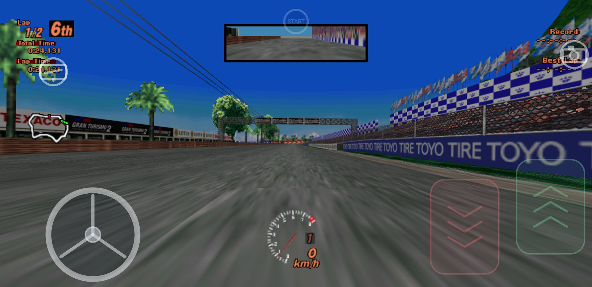
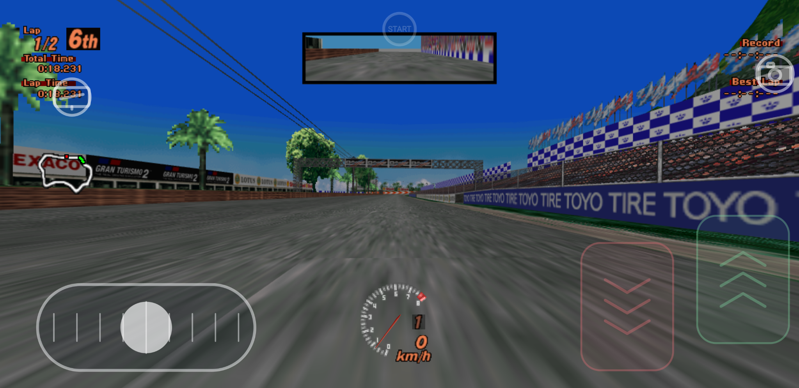
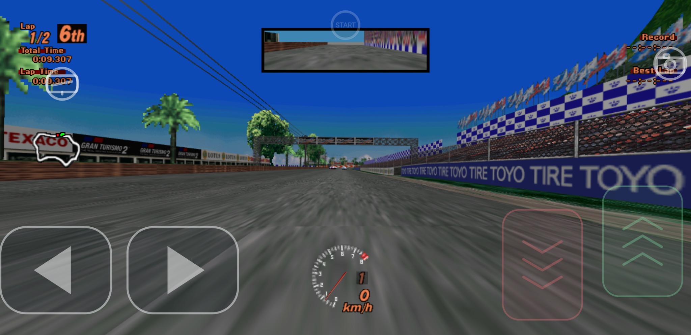
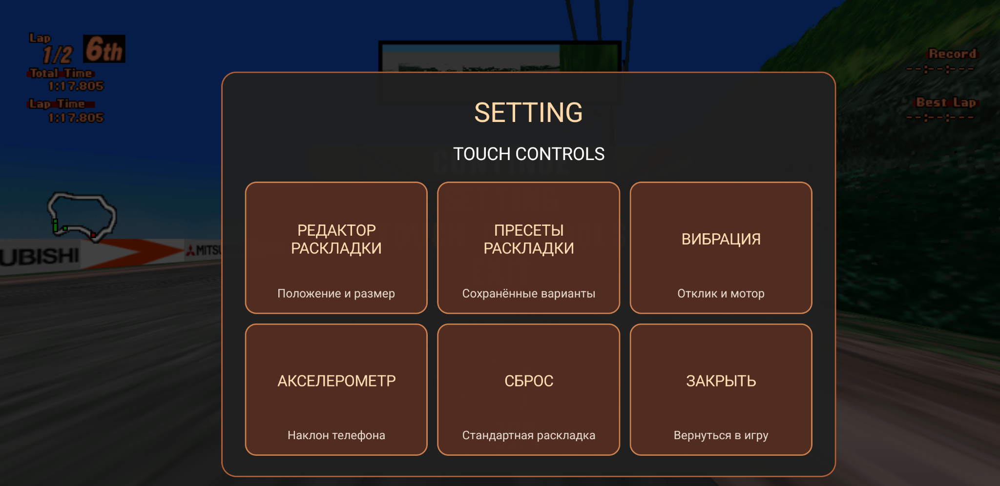
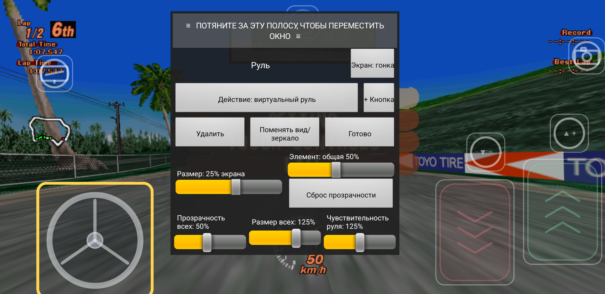
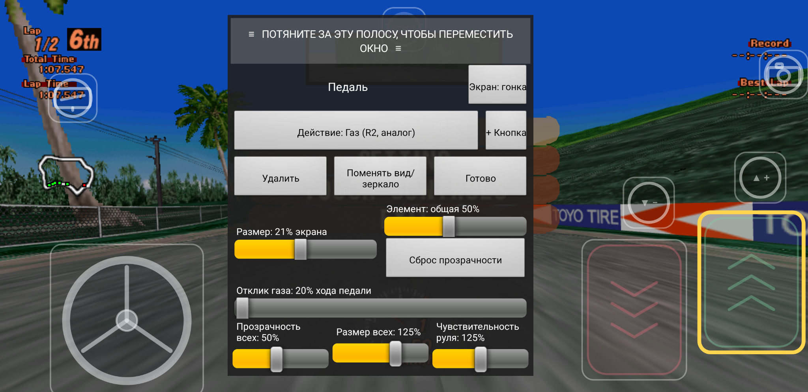
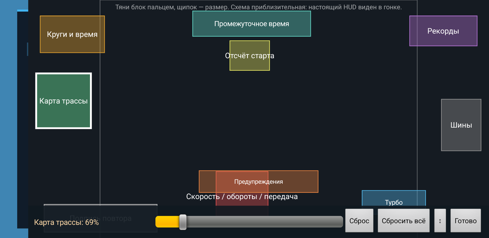
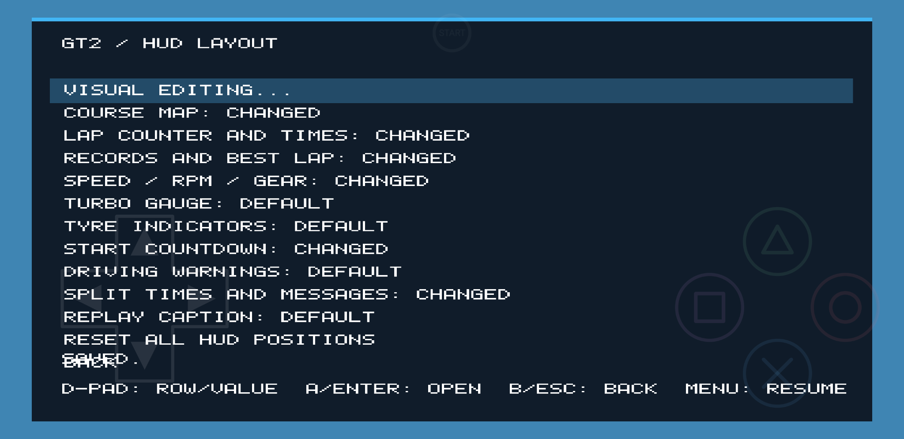
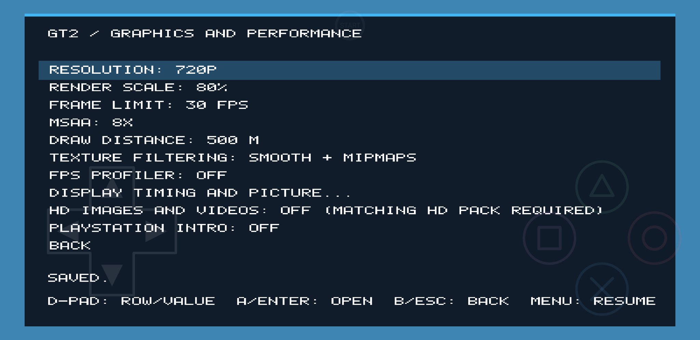
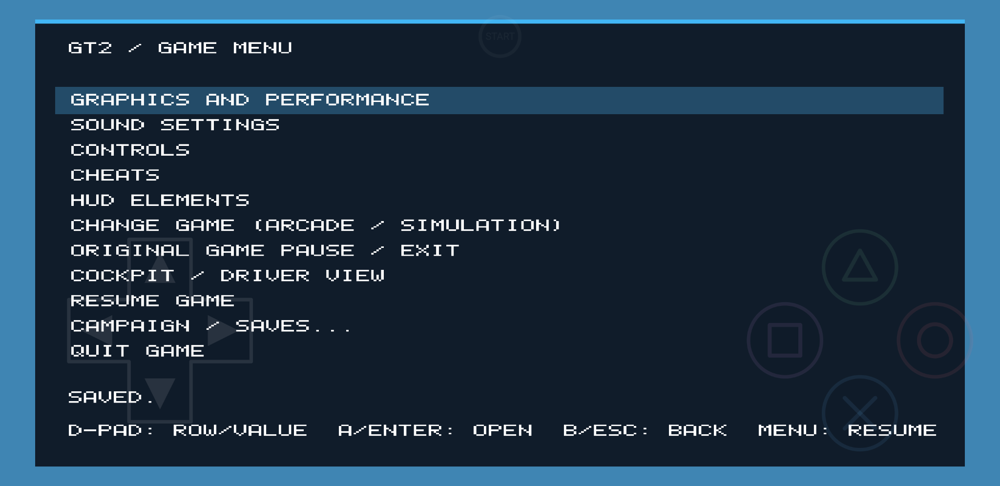

**Язык / Language:** [🇬🇧 English](README_EN.md) · 🇷🇺 Русский · [🏠 Главная](README.md)

---

## 🇷🇺 Русский

### О проекте

**GT2 Android** — порт Gran Turismo 2 для Android, адаптированный для обычных 2D-экранов и сенсорного управления. Проект основан на Android/VR-разработке оригинального [Gran Turismo 2 PC & VR](https://github.com/dubrovskiy-yevhen-stakelogic/gt-2-pc), но переработан для игры на смартфоне без VR-шлема.

### Возможности

- Три варианта управления рулём: виртуальный руль, ползунок и кнопки влево/вправо.
- Настройка чувствительности руля и отклика педали газа.
- Настраиваемый HUD: перемещение и изменение размера экранных элементов.
- Вибрация при нажатии сенсорных кнопок, столкновениях и движении по дорожному покрытию.
- Применение настроек управления и интерфейса без перезапуска игры.
- Встроенные настройки графики, звука и управления.

### Скриншоты

| Виртуальный руль | Ползунок руля |
|:---:|:---:|
|  |  |

| Кнопки поворота | Настройки сенсорного управления |
|:---:|:---:|
|  |  |

| Редактор руля | Редактор педали газа |
|:---:|:---:|
|  |  |

| Редактор HUD | Расположение HUD |
|:---:|:---:|
|  |  |

| Настройки графики | Меню игры |
|:---:|:---:|
|  |  |

### Системные требования

- Android 9 или новее, устройство с архитектурой ARM64.
- Видеодрайвер с поддержкой **Vulkan 1.3 и dynamic rendering**.
- Совместимость зависит от модели устройства, версии Android и графического драйвера. Vulkan 1.3 обязателен; некоторым старым устройствам Adreno может потребоваться совместимый драйвер Turnip.

### Быстрый запуск

1. Откройте страницу [**Релизы**](https://github.com/PhantasmProject/gt2-android/releases/latest).
2. Скачайте APK для Android и установите его на смартфон. Если Android запросит разрешение, разрешите установку приложений из этого источника.
3. Подготовьте игровые данные с помощью Windows-инструмента из инструкции [Подготовка игровых данных](docs/GAME-DATA.md).
4. Перенесите готовый ZIP на телефон и распакуйте его непосредственно на смартфоне.
5. Запустите GT2 Android. При появлении системного выбора папки укажите папку, внутри которой находятся `arcade` и/или `simulation`, либо выберите одну из этих папок напрямую.
6. Предоставьте запрошенный доступ к хранилищу и вернитесь в игру.

Игра читает выбранные файлы непосредственно из указанной папки. Копировать или конвертировать игровые данные на телефоне не требуется.

### Документация

| Инструкция | Что внутри |
|---|---|
| [Установка на Android](docs/INSTALLATION.md) | Установка APK, первый запуск, выбор папки с данными и решение проблем |
| [Подготовка игровых данных на Windows](docs/GAME-DATA.md) | Архив `GT2 Preparing Data.zip`, запуск `INSTALL.bat`, образы дисков и перенос на телефон |
| [Сборка из исходников](docs/BUILD.md) | WSL/Ubuntu, скрипт сборки APK и все режимы |
| [Техническая документация Android](docs/ANDROID.md) | Работа приложения, сенсорное управление, графика и сведения для разработчиков |

### Релизы и загрузки

Официальные файлы проекта находятся на странице **Releases**:

- [Последний релиз GT2 Android](https://github.com/PhantasmProject/gt2-android/releases/latest)
- [Все релизы](https://github.com/PhantasmProject/gt2-android/releases)

Для установки игры скачивайте APK. ZIP с исходниками предназначен разработчикам для изучения и самостоятельной сборки. Отдельный архив **GT2 Preparing Data.zip** — это Windows-инструмент подготовки игровых данных, а не установочный APK.

### Проверенные устройства

На данный момент тестирование проводилось на следующих устройствах:

| Устройство | Процессор | Графический процессор |
|---|---|---|
| Google Pixel 3 XL | Qualcomm Snapdragon 845 | Adreno 630 |
| Samsung Galaxy S24 Ultra | Qualcomm Snapdragon 8 Gen 3 | Adreno 750 |

Это список проверенных устройств, а не полный перечень совместимых моделей.

### Статус проекта

🚧 **В разработке.** Это ранний публичный релиз. Возможны ошибки, различия в производительности и проблемы графики на отдельных устройствах. При сообщении об ошибке указывайте модель устройства, версию Android и, если возможно, содержимое `gt2game-error.log`.

### Благодарности

Отдельная благодарность [Yevhen Dubrovskiy](https://github.com/dubrovskiy-yevhen-stakelogic) — автору оригинального проекта [Gran Turismo 2 PC & VR](https://github.com/dubrovskiy-yevhen-stakelogic/gt-2-pc). GT2 Android использует наработки этого проекта и адаптирует Android-версию для обычного экрана смартфона и сенсорного управления.

### Игровые данные и юридическая информация

В репозитории и релизах **не распространяются** образы дисков Gran Turismo 2, BIOS/прошивки, игровые ресурсы, защищённые авторским правом, или файлы сохранений. Пользователь должен самостоятельно предоставить собственные легально полученные игровые данные. Не загружайте в репозиторий образы дисков, BIOS и другие материалы, защищённые авторским правом.

Gran Turismo 2 и связанные с ней товарные знаки принадлежат соответствующим правообладателям. Это независимый проект сообщества, не связанный с Sony Interactive Entertainment или Polyphony Digital и не одобренный ими.

### Лицензия

См. файл [LICENSE](LICENSE). Лицензия распространяется только на материалы, которые она покрывает, и не предоставляет прав на товарные знаки Gran Turismo 2, игровые данные, прошивки и сторонние материалы, защищённые авторским правом. При публикации сохраняйте уведомления об авторстве и лицензиях оригинального проекта.

---

**Built with respect for the original work. / Создано с уважением к оригинальной работе.**

