

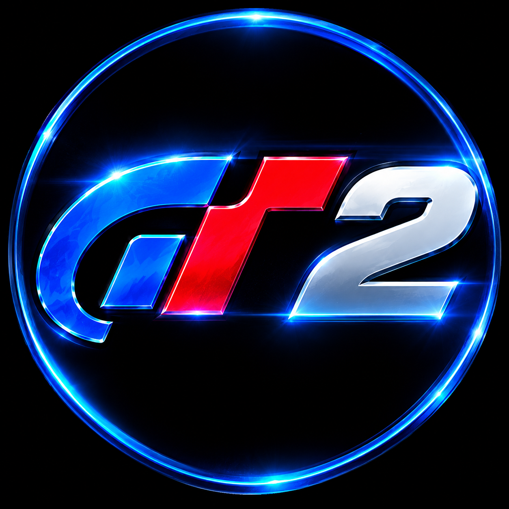

# GT2 Android

**Gran Turismo 2 — Android port with touchscreen controls and a mobile-optimized interface.**

*Bringing the classic Gran Turismo 2 experience to Android touchscreens.*

[ **Download latest release** ](https://github.com/PhantasmProject/gt2-android/releases/latest) ·
[ **Installation guide** ](docs/INSTALLATION.md) ·
[ **Build from source** ](docs/BUILD.md)

---

## 🎬 Video demonstration

**▶ Click the preview to watch the video on YouTube**

---

## 🇬🇧 English

### About

**GT2 Android** is an Android port of Gran Turismo 2, adapted for regular 2D screens and touchscreen gameplay. It builds on the Android/VR work of the original [Gran Turismo 2 PC & VR project](https://github.com/dubrovskiy-yevhen-stakelogic/gt-2-pc), reworked here for a traditional mobile experience without a VR headset.

### Features

- Three steering options: virtual steering wheel, steering slider, and left/right buttons.
- Adjustable steering sensitivity and throttle response.
- Customizable HUD: move and resize on-screen elements.
- Touch-button vibration and in-game rumble feedback.
- Live control and interface settings, applied without restarting the game.
- Bluetooth and USB gamepad/keyboard support alongside touch controls.
- In-game graphics, sound and controls settings.

### Screenshots

| Virtual steering wheel | Steering slider |
|:---:|:---:|
| 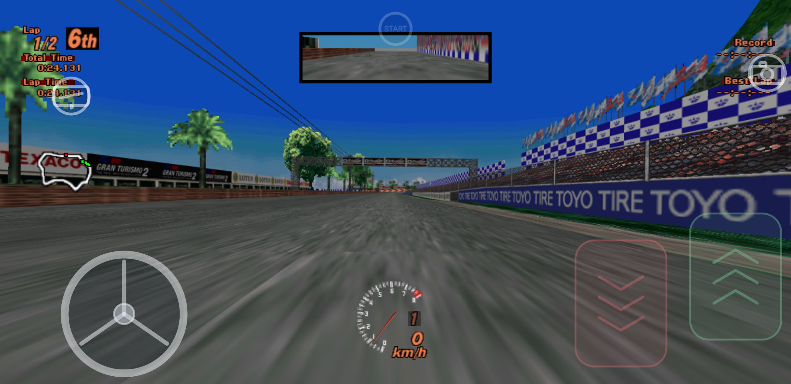 | 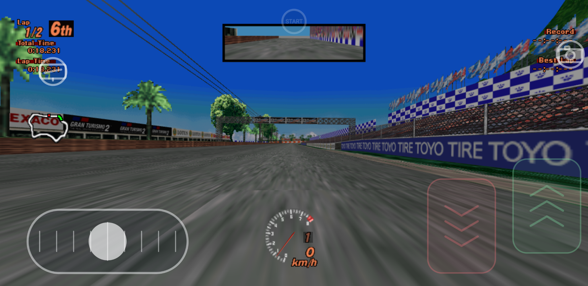 |

| Left/right buttons | Touch settings |
|:---:|:---:|
| 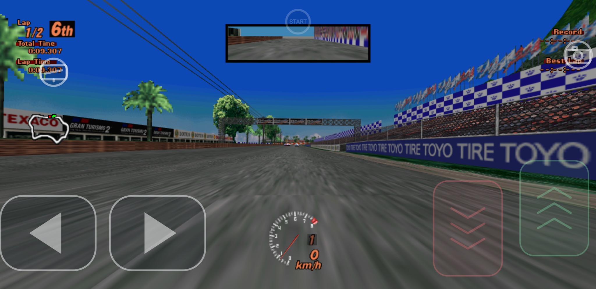 | 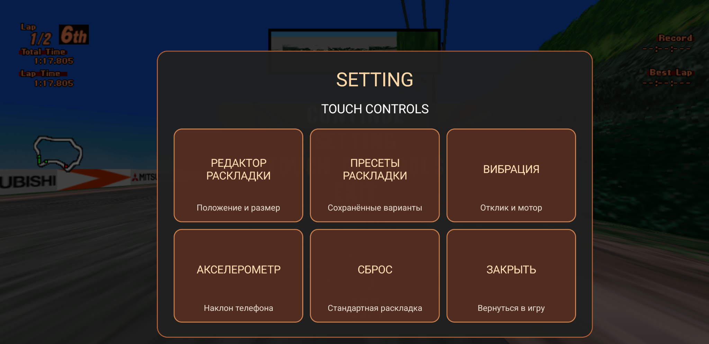 |

| Steering editor | Throttle editor |
|:---:|:---:|
| 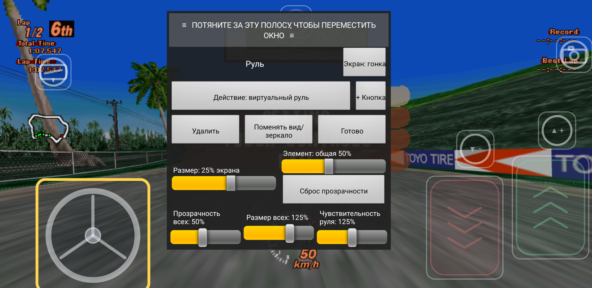 | 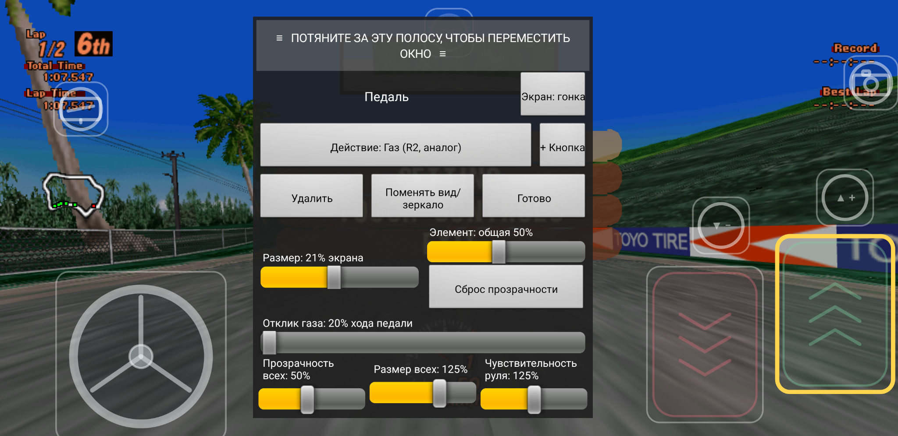 |

| HUD editor | HUD layout |
|:---:|:---:|
| 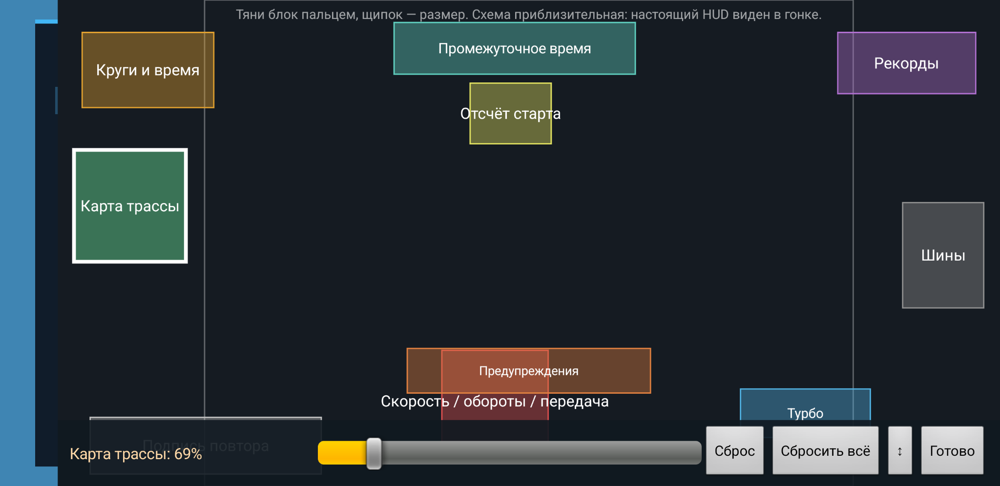 | 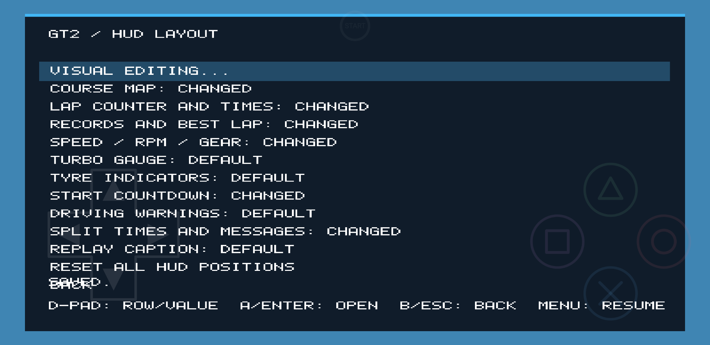 |

| Graphics settings | Game menu |
|:---:|:---:|
| 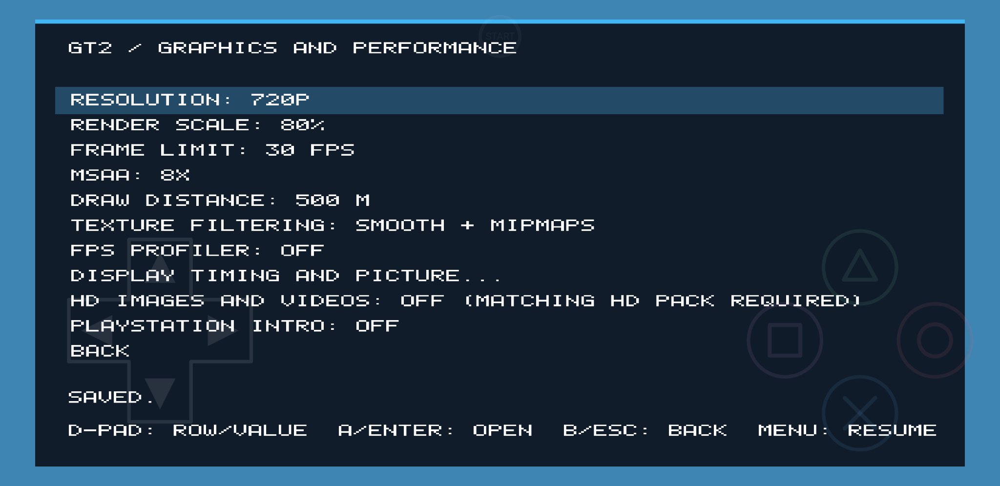 | 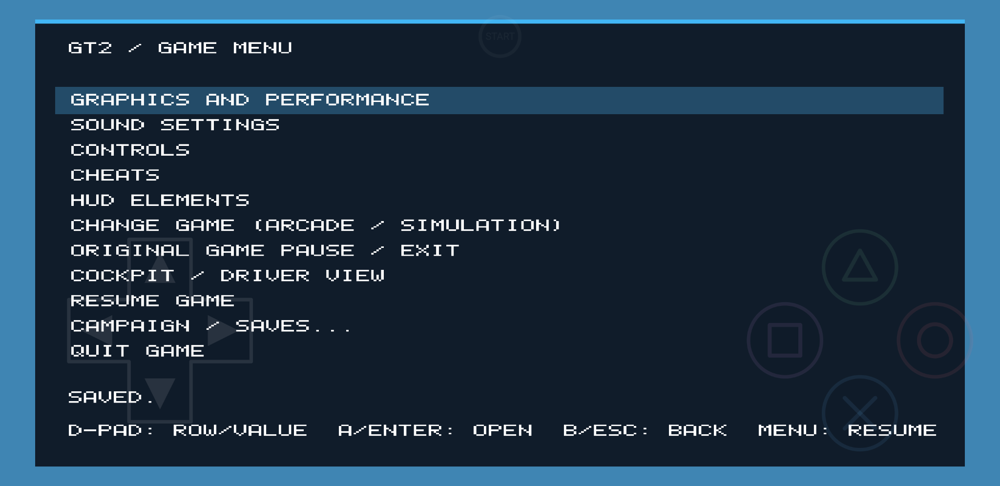 |

### Requirements

- Android 9 or newer, ARM64 device.
- A GPU driver supporting **Vulkan 1.3 with dynamic rendering**.
- Compatibility depends on the device, Android version and graphics driver. Vulkan 1.3 support is mandatory; some older Adreno devices may need a compatible Turnip driver.

### Quick start

1. Open [**Releases**](https://github.com/PhantasmProject/gt2-android/releases/latest).
2. Download the Android APK and install it on your phone. If Android asks, allow installation from that source.
3. Prepare your own GT2 game data using the Windows tool described in [Game data preparation](docs/GAME-DATA.md).
4. Transfer the prepared ZIP to your phone and extract it there.
5. Launch GT2 Android. When the Android folder picker appears, select the folder containing `arcade` and/or `simulation` (or select one of those folders directly).
6. Grant the requested storage access and return to the game.

The game reads the selected folder in place. It does not copy or convert game data on the phone.

### Documentation

| Guide | Description |
|---|---|
| [Installation on Android](docs/INSTALLATION.md) | APK installation, first launch, data folder selection and troubleshooting |
| [Preparing game data on Windows](docs/GAME-DATA.md) | `GT2 Preparing Data.zip`, `INSTALL.bat`, supported disc images and transfer to phone |
| [Build from source](docs/BUILD.md) | WSL/Ubuntu setup, APK build script and all build modes |
| [Android technical notes](docs/ANDROID.md) | Runtime behavior, touch controls, graphics and developer details |

### Releases and downloads

The **Releases** page is the official download location:

- [Latest GT2 Android release](https://github.com/PhantasmProject/gt2-android/releases/latest)
- [All releases](https://github.com/PhantasmProject/gt2-android/releases)

Download the APK to install the game. The source ZIP is intended for developers who want to inspect or build the project. The separate **GT2 Preparing Data.zip** archive is the Windows game-data preparation toolkit; it is not the Android APK.

### Tested devices

Testing has been performed on:

| Device | SoC | GPU |
|---|---|---|
| Google Pixel 3 XL | Qualcomm Snapdragon 845 | Adreno 630 |
| Samsung Galaxy S24 Ultra | Qualcomm Snapdragon 8 Gen 3 | Adreno 750 |

These are the currently reported test devices, not a complete compatibility list.

### Project status

🚧 **Work in progress.** This is an early public release. Bugs, performance differences and device-specific graphics issues are possible. Please include your device model, Android version and relevant `gt2game-error.log` information when reporting a problem.

### Credits

A special thank-you to [Yevhen Dubrovskiy](https://github.com/dubrovskiy-yevhen-stakelogic) for creating the original [Gran Turismo 2 PC & VR project](https://github.com/dubrovskiy-yevhen-stakelogic/gt-2-pc). GT2 Android builds on that work and adapts its Android implementation for flat-screen mobile gameplay and touch controls.

### Game data and legal notice

This repository and its releases do **not** distribute Gran Turismo 2 disc images, BIOS/firmware, copyrighted game assets or save files. You must provide your own legally obtained game data. Do not upload disc images, BIOS files or copyrighted game content to this repository.

Gran Turismo, Gran Turismo 2 and related marks belong to their respective owners. This is an independent community project and is not affiliated with, endorsed by, or sponsored by Sony Interactive Entertainment or Polyphony Digital.

### License

See [LICENSE](LICENSE). The included license applies only to the code and materials it covers. It does not grant rights to Gran Turismo trademarks, game data, firmware or third-party copyrighted material. Preserve upstream copyright and license notices.

---

## 🇷🇺 Русский

### О проекте

**GT2 Android** — порт Gran Turismo 2 для Android, адаптированный для обычных 2D-экранов и сенсорного управления. Проект основан на Android/VR-разработке оригинального [Gran Turismo 2 PC & VR](https://github.com/dubrovskiy-yevhen-stakelogic/gt-2-pc), но переработан для игры на смартфоне без VR-шлема.

### Возможности

- Три варианта управления рулём: виртуальный руль, ползунок и кнопки влево/вправо.
- Настройка чувствительности руля и отклика педали газа.
- Настраиваемый HUD: перемещение и изменение размера экранных элементов.
- Вибрация при нажатии сенсорных кнопок, столкновениях и движении по дорожному покрытию.
- Применение настроек управления и интерфейса без перезапуска игры.
- Поддержка Bluetooth- и USB-геймпадов, а также клавиатуры.
- Встроенные настройки графики, звука и управления.

### Скриншоты

| Виртуальный руль | Ползунок руля |
|:---:|:---:|
|  |  |

| Кнопки поворота | Настройки сенсорного управления |
|:---:|:---:|
|  |  |

| Редактор руля | Редактор педали газа |
|:---:|:---:|
|  |  |

| Редактор HUD | Расположение HUD |
|:---:|:---:|
|  |  |

| Настройки графики | Меню игры |
|:---:|:---:|
|  |  |

### Системные требования

- Android 9 или новее, устройство с архитектурой ARM64.
- Видеодрайвер с поддержкой **Vulkan 1.3 и dynamic rendering**.
- Совместимость зависит от модели устройства, версии Android и графического драйвера. Vulkan 1.3 обязателен; некоторым старым устройствам Adreno может потребоваться совместимый драйвер Turnip.

### Быстрый запуск

1. Откройте страницу [**Релизы**](https://github.com/PhantasmProject/gt2-android/releases/latest).
2. Скачайте APK для Android и установите его на смартфон. Если Android запросит разрешение, разрешите установку приложений из этого источника.
3. Подготовьте игровые данные с помощью Windows-инструмента из инструкции [Подготовка игровых данных](docs/GAME-DATA.md).
4. Перенесите готовый ZIP на телефон и распакуйте его непосредственно на смартфоне.
5. Запустите GT2 Android. При появлении системного выбора папки укажите папку, внутри которой находятся `arcade` и/или `simulation`, либо выберите одну из этих папок напрямую.
6. Предоставьте запрошенный доступ к хранилищу и вернитесь в игру.

Игра читает выбранные файлы непосредственно из указанной папки. Копировать или конвертировать игровые данные на телефоне не требуется.

### Документация

| Инструкция | Что внутри |
|---|---|
| [Установка на Android](docs/INSTALLATION.md) | Установка APK, первый запуск, выбор папки с данными и решение проблем |
| [Подготовка игровых данных на Windows](docs/GAME-DATA.md) | Архив `GT2 Preparing Data.zip`, запуск `INSTALL.bat`, образы дисков и перенос на телефон |
| [Сборка из исходников](docs/BUILD.md) | WSL/Ubuntu, скрипт сборки APK и все режимы |
| [Техническая документация Android](docs/ANDROID.md) | Работа приложения, сенсорное управление, графика и сведения для разработчиков |

### Релизы и загрузки

Официальные файлы проекта находятся на странице **Releases**:

- [Последний релиз GT2 Android](https://github.com/PhantasmProject/gt2-android/releases/latest)
- [Все релизы](https://github.com/PhantasmProject/gt2-android/releases)

Для установки игры скачивайте APK. ZIP с исходниками предназначен разработчикам для изучения и самостоятельной сборки. Отдельный архив **GT2 Preparing Data.zip** — это Windows-инструмент подготовки игровых данных, а не установочный APK.

### Проверенные устройства

На данный момент тестирование проводилось на следующих устройствах:

| Устройство | Процессор | Графический процессор |
|---|---|---|
| Google Pixel 3 XL | Qualcomm Snapdragon 845 | Adreno 630 |
| Samsung Galaxy S24 Ultra | Qualcomm Snapdragon 8 Gen 3 | Adreno 750 |

Это список проверенных устройств, а не полный перечень совместимых моделей.

### Статус проекта

🚧 **В разработке.** Это ранний публичный релиз. Возможны ошибки, различия в производительности и проблемы графики на отдельных устройствах. При сообщении об ошибке указывайте модель устройства, версию Android и, если возможно, содержимое `gt2game-error.log`.

### Благодарности

Отдельная благодарность [Yevhen Dubrovskiy](https://github.com/dubrovskiy-yevhen-stakelogic) — автору оригинального проекта [Gran Turismo 2 PC & VR](https://github.com/dubrovskiy-yevhen-stakelogic/gt-2-pc). GT2 Android использует наработки этого проекта и адаптирует Android-версию для обычного экрана смартфона и сенсорного управления.

### Игровые данные и юридическая информация

В репозитории и релизах **не распространяются** образы дисков Gran Turismo 2, BIOS/прошивки, игровые ресурсы, защищённые авторским правом, или файлы сохранений. Пользователь должен самостоятельно предоставить собственные легально полученные игровые данные. Не загружайте в репозиторий образы дисков, BIOS и другие материалы, защищённые авторским правом.

Gran Turismo, Gran Turismo 2 и связанные с ними товарные знаки принадлежат соответствующим правообладателям. Это независимый проект сообщества, не связанный с Sony Interactive Entertainment или Polyphony Digital и не одобренный ими.

### Лицензия

См. файл [LICENSE](LICENSE). Лицензия распространяется только на материалы, которые она покрывает, и не предоставляет прав на товарные знаки Gran Turismo, игровые данные, прошивки и сторонние материалы, защищённые авторским правом. При публикации сохраняйте уведомления об авторстве и лицензиях оригинального проекта.

---

**Built with respect for the original work. / Создано с уважением к оригинальной работе.**

